# Taller: sitio web con Nginx y DuckDNS en Oracle Cloud

**Estudiantes:** Samuel Enrique Prieto Lozano y Daniela Ramirez  
**Curso:** Infraestructura TI y Cloud Computing  
**Institución:** Uniempresarial  
**Fecha:** octubre de 2026

| Dato | Valor |
| --- | --- |
| Instancia | `servidor-web-2` |
| Sistema operativo | Oracle Linux 9.8 |
| IP pública | `157.137.210.124` |
| Usuario SSH | `opc` |
| Subdominio | `sam-daniela.duckdns.org` |
| URL del sitio | `http://sam-daniela.duckdns.org` |
| Repositorio | `https://github.com/iNxTSam/taller-nginx-web` |
| Guía en GitHub | `https://github.com/iNxTSam/taller-nginx-web/blob/main/README.md` |

> **Entrega:** este documento es la guía del taller. El sitio está disponible en `http://sam-daniela.duckdns.org` y el repositorio es público.

## Contenido

1. [Resumen de la solución](#1-resumen-de-la-solución)
2. [Arquitectura](#2-arquitectura)
3. [Requisitos](#3-requisitos)
4. [Paso 1: verificar la máquina virtual](#paso-1-verificar-la-máquina-virtual)
5. [Paso 2: conectarse por SSH](#paso-2-conectarse-por-ssh)
6. [Paso 3: instalar y activar Nginx](#paso-3-instalar-y-activar-nginx)
7. [Paso 4: abrir el puerto 80](#paso-4-abrir-el-puerto-80)
8. [Paso 5: publicar el repositorio en GitHub](#paso-5-publicar-el-repositorio-en-github)
9. [Paso 6: clonar el sitio en la VM y publicarlo](#paso-6-clonar-el-sitio-en-la-vm-y-publicarlo)
10. [Paso 7: configurar Nginx y SELinux](#paso-7-configurar-nginx-y-selinux)
11. [Paso 8: configurar DuckDNS](#paso-8-configurar-duckdns)
12. [Paso 9: verificar desde un navegador externo](#paso-9-verificar-desde-un-navegador-externo)
13. [Capturas](#capturas)
14. [Problemas comunes](#problemas-comunes)
15. [Checklist final](#checklist-final)

## 1. Resumen de la solución

Se utilizó la instancia **servidor-web-2** de Oracle Cloud Infrastructure (OCI), diferente de la instancia `servidor-web` del taller inicial. La VM usa **Oracle Linux 9.8**, tiene una IP pública y pertenece a la VCN `red-infraestructura` del taller.

Sobre la VM se instaló y activó **Nginx**, se publicó un sitio estático en `/var/www/mi-sitio` y se configuró un **subdominio gratuito de DuckDNS** para acceder por HTTP:

```text
http://sam-daniela.duckdns.org
```

El sitio tiene cuatro secciones (Inicio, Sobre nosotros, Proyectos y Contacto), imágenes SVG locales, estilos CSS adaptables a móvil y funcionalidades en JavaScript: cambio de tema claro/oscuro, menú móvil, filtros de proyectos, ventana modal y validación del formulario.

La guía, el código del sitio y las capturas están publicados en GitHub.

### Estructura del repositorio

```text
taller-nginx-web/
├── README.md                 Guía del taller (este documento)
├── assets/
│   └── arquitectura.svg      Diagrama de la solución
├── capturas/                 Capturas reales del proceso y del sitio
├── nginx/
│   └── mi-sitio.conf         Configuración de Nginx
└── sitio/                    Sitio web publicado en la VM
    ├── index.html
    ├── css/styles.css
    ├── js/main.js
    └── img/
        ├── hero.svg
        ├── proyecto-1.svg
        ├── proyecto-2.svg
        ├── proyecto-3.svg
        └── favicon.svg
```

## 2. Arquitectura

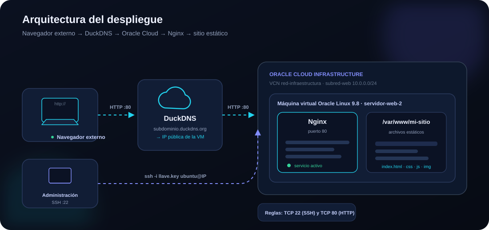

Flujo de una visita:

1. El navegador consulta `sam-daniela.duckdns.org`.
2. DuckDNS responde con la IP pública `157.137.210.124`.
3. La petición HTTP llega al puerto 80 de la VM.
4. La Security List de OCI y `firewalld` permiten el tráfico.
5. Nginx recibe la petición y sirve los archivos de `/var/www/mi-sitio`.
6. El navegador recibe `index.html`, la hoja de estilos, el JavaScript y las imágenes.

## 3. Requisitos

- Cuenta de Oracle Cloud con acceso a la instancia `servidor-web-2`.
- Llave SSH privada asociada a la instancia, disponible en Oracle Cloud Shell.
- Cuenta de DuckDNS.
- Cuenta de GitHub.
- Navegador externo a la VM (computador o celular con datos móviles).

## Paso 1: verificar la máquina virtual

1. En la consola de OCI, abre **Compute → Instances**.
2. Verifica que la instancia `servidor-web-2` esté en estado **Running**.
3. Confirma los datos de la instancia:
   - **Imagen:** Oracle Linux 9.8.
   - **Forma:** `VM.Standard.E5.Flex`, 1 OCPU y 12 GB de memoria.
   - **IP pública:** `157.137.210.124`.
   - **Usuario SSH:** `opc`.
   - **VCN:** `red-infraestructura`, subred `subred-web`.
4. Esta instancia es diferente de `servidor-web`, la utilizada en el taller inicial. La instancia ya estaba creada para el taller; en esta práctica se verificó su estado y se inició cuando estaba detenida.

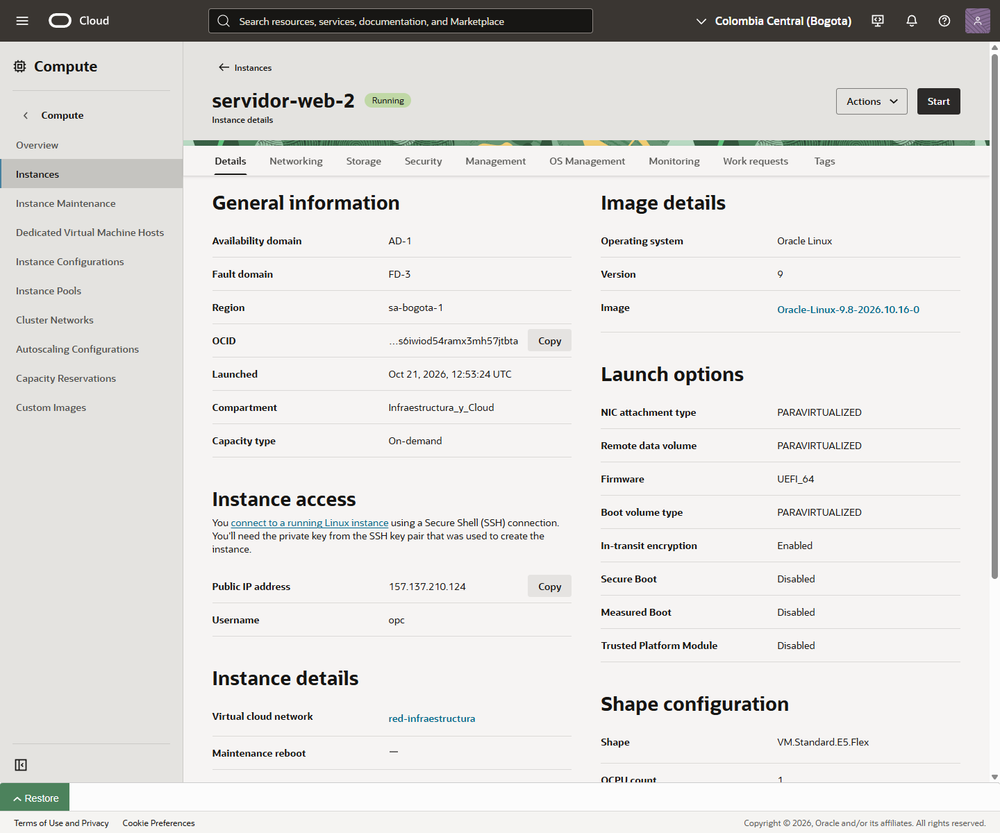

> Si la instancia está detenida, usa el botón **Start** y espera a que el estado cambie a **Running**. La IP pública se conserva mientras la instancia permanezca en ejecución.

## Paso 2: conectarse por SSH

El acceso se realizó desde **Oracle Cloud Shell**, que ya tiene la llave privada de la instancia.

1. En la consola de OCI, abre **Developer tools → Cloud Shell**.
2. Espera a que aparezca el prompt de Cloud Shell.
3. Conéctate a la VM:

   ```bash
   ssh -i ~/llave-web-2.key opc@157.137.210.124
   ```

4. Verifica que estás dentro de la instancia:

   ```bash
   whoami
   hostname
   cat /etc/oracle-release
   ```

   El resultado debe ser el usuario `opc`, el hostname `servidor-web-2` y Oracle Linux Server 9.8.

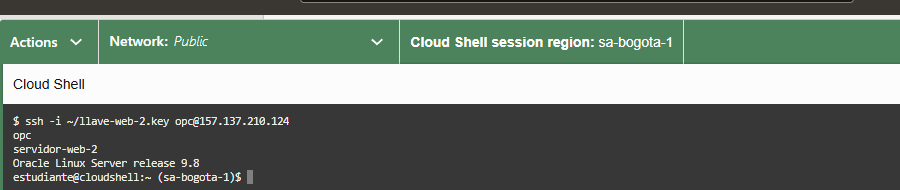

> También se puede conectar desde PowerShell con la llave privada descargada:
>
> ```powershell
> icacls "C:\ruta\a\la-llave.key" /inheritance:r
> icacls "C:\ruta\a\la-llave.key" /grant:r "$($env:USERNAME):(R)"
> ssh -i "C:\ruta\a\la-llave.key" opc@157.137.210.124
> ```

## Paso 3: instalar y activar Nginx

Los comandos se ejecutan dentro de la VM.

1. Verifica si Nginx ya está instalado:

   ```bash
   nginx -v
   ```

2. Si no está instalado, instálalo con `dnf`:

   ```bash
   sudo dnf install -y nginx
   ```

3. Habilita el servicio para que arranque con la VM y lo inicia:

   ```bash
   sudo systemctl enable --now nginx
   ```

4. Comprueba el estado:

   ```bash
   systemctl is-active nginx
   sudo systemctl status nginx --no-pager
   ```

5. Verifica que el puerto 80 esté siendo atendido por Nginx:

   ```bash
   sudo ss -tlnp | grep ':80 '
   systemctl is-active nginx
   ```

   Nginx debe aparecer como el proceso que escucha en el puerto 80 y el servicio debe estar `active`.

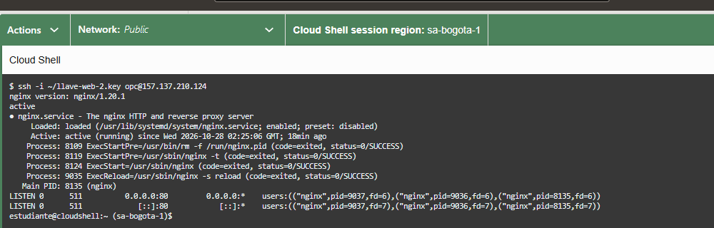

## Paso 4: abrir el puerto 80

Hay dos capas de red que deben permitir HTTP: la **Security List de OCI** y el **firewall de la VM**.

1. En OCI, abre **Networking → Virtual Cloud Networks → red-infraestructura → Security Lists**.
2. Verifica que exista una regla de entrada:
   - **Source CIDR:** `0.0.0.0/0`.
   - **IP Protocol:** TCP.
   - **Destination Port Range:** `80`.
3. En la VM, revisa `firewalld`:

   ```bash
   sudo firewall-cmd --list-all
   ```

   La salida debe incluir el servicio `http` y el puerto `80/tcp`.

4. Si el servicio no está habilitado, agrégalo y recarga:

   ```bash
   sudo firewall-cmd --permanent --add-service=http
   sudo firewall-cmd --reload
   ```

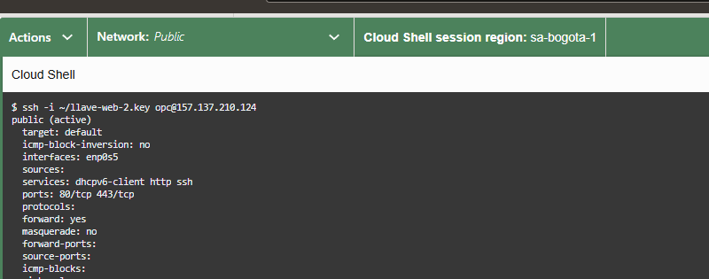

> La Security List ya permitía el puerto 80 desde el taller inicial. No se modificaron reglas de red de OCI durante esta práctica; se verificó el acceso externo en el paso 9.

## Paso 5: publicar el repositorio en GitHub

El repositorio se creó público para que el docente pueda abrir la guía y visualizar las capturas.

1. Crea un repositorio público llamado `taller-nginx-web`.
2. Desde la carpeta local del proyecto:

   ```powershell
   cd C:\Users\inxts\taller-nginx-web
   git init
   git add .
   git commit -m "Sitio web y guia del taller de Nginx y DuckDNS"
   git branch -M main
   git remote add origin https://github.com/iNxTSam/taller-nginx-web.git
   git push -u origin main
   ```

3. Verifica que el repositorio sea público y que las imágenes se vean en `README.md`.
4. Comprueba el acceso desde una ventana de incógnito.
5. Copia el enlace directo a la guía:

   ```text
   https://github.com/iNxTSam/taller-nginx-web/blob/main/README.md
   ```

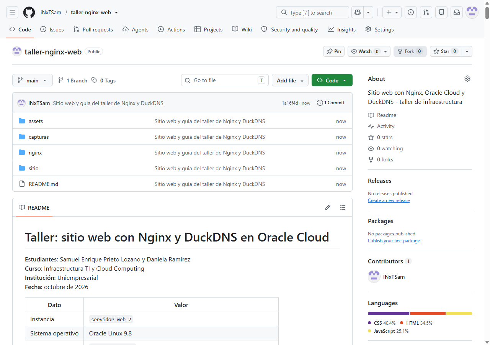

## Paso 6: clonar el sitio en la VM y publicarlo

El sitio se publica desde GitHub hacia la VM, sin subir archivos manualmente.

1. Conéctate a la VM desde Cloud Shell y clona el repositorio dentro de ella:

   ```bash
   ssh -i ~/llave-web-2.key opc@157.137.210.124
   cd ~
   git clone https://github.com/iNxTSam/taller-nginx-web.git
   ```

   Si el repositorio ya existe en la VM, actualízalo con:

   ```bash
   cd ~/taller-nginx-web
   git pull
   ```

2. Copia la carpeta `sitio/` al directorio web y ajusta propietario y permisos:

   ```bash
   sudo mkdir -p /var/www/mi-sitio
   sudo cp -r ~/taller-nginx-web/sitio/. /var/www/mi-sitio/
   sudo chown -R nginx:nginx /var/www/mi-sitio
   sudo chmod -R u=rwX,go=rX /var/www/mi-sitio
   ```

3. Configura el contexto SELinux. Sin este paso Nginx devuelve `403 Forbidden` en Oracle Linux:

   ```bash
   sudo semanage fcontext -a -t httpd_sys_content_t '/var/www/mi-sitio(/.*)?'
   sudo restorecon -Rv /var/www/mi-sitio
   ```

   Si `semanage` no existe, instala primero:

   ```bash
   sudo dnf install -y policycoreutils-python-utils
   ```

4. Verifica los archivos:

   ```bash
   ls -la /var/www/mi-sitio
   ls -la /var/www/mi-sitio/css /var/www/mi-sitio/js /var/www/mi-sitio/img
   ```

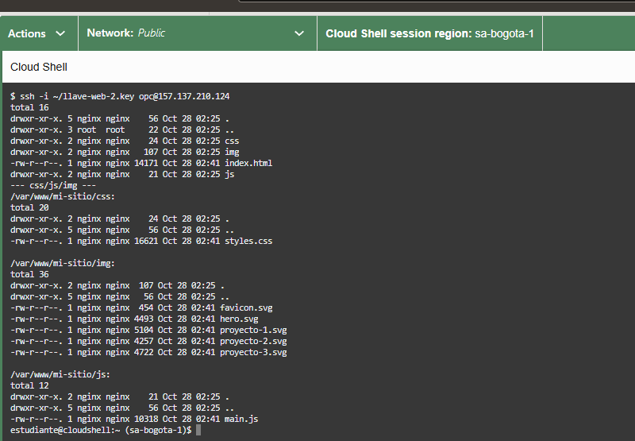

## Paso 7: configurar Nginx y SELinux

1. Crea el archivo de configuración:

   ```bash
   sudo nano /etc/nginx/conf.d/mi-sitio.conf
   ```

2. Pega esta configuración. En Oracle Linux los sitios se guardan en `/etc/nginx/conf.d/`, no en `sites-available`:

   ```nginx
   server {
       listen 80;
       server_name sam-daniela.duckdns.org 157.137.210.124 localhost;

       root /var/www/mi-sitio;
       index index.html;

       access_log /var/log/nginx/mi-sitio.access.log;
       error_log  /var/log/nginx/mi-sitio.error.log;

       location / {
           try_files $uri $uri/ =404;
       }

       location ~* \.(css|js|svg|png|jpg|jpeg|webp|ico)$ {
           expires 7d;
           add_header Cache-Control "public";
       }
   }
   ```

   - `listen 80`: atiende HTTP en el puerto 80.
   - `server_name`: responde al dominio de DuckDNS, a la IP y a `localhost`.
   - `root`: carpeta con los archivos publicados.
   - `try_files`: entrega el archivo solicitado o devuelve 404.

3. Valida la sintaxis y recarga Nginx:

   ```bash
   sudo nginx -t
   sudo systemctl reload nginx
   ```

4. Prueba el sitio con el dominio:

   ```bash
   curl -sI http://sam-daniela.duckdns.org | head -n 1
   curl -s http://sam-daniela.duckdns.org | grep -o 'Sam y Daniela' | head -n 1
   ```

   La respuesta debe ser `HTTP/1.1 200 OK` y debe aparecer `Sam y Daniela`.

5. Si `curl http://localhost` devuelve la página por defecto de Nginx, prueba con IPv4 (`curl -4`) o usa el dominio. En Oracle Linux el bloque por defecto también escucha en IPv6.

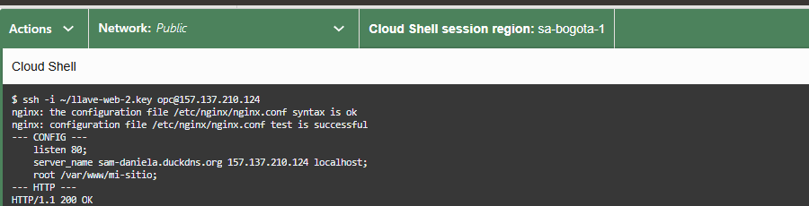

## Paso 8: configurar DuckDNS

1. Inicia sesión en [https://www.duckdns.org](https://www.duckdns.org) con GitHub o Google.
2. En el campo **subdomain**, escribe `sam-daniela` y haz clic en **add domain**.
3. En el campo **current ip**, escribe `157.137.210.124` y haz clic en **update ip**.
4. Confirma que el panel muestre el mensaje de éxito y la IP correcta.
5. Verifica la resolución DNS desde PowerShell:

   ```powershell
   nslookup sam-daniela.duckdns.org
   Resolve-DnsName sam-daniela.duckdns.org
   ```

   La respuesta debe ser `157.137.210.124`.

6. Si la IP de la instancia cambia, actualiza el campo **current ip** en DuckDNS.

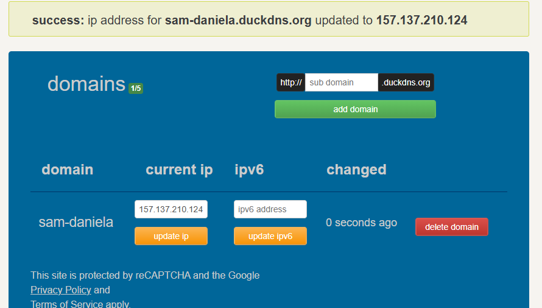

> El token de DuckDNS es privado y no se publica en el repositorio. La captura fue recortada para no mostrar la sección de la cuenta.

## Paso 9: verificar desde un navegador externo

1. En un computador externo a la VM, abre una ventana de incógnito.
2. Escribe la URL completa, con `http://`:

   ```text
   http://sam-daniela.duckdns.org
   ```

3. Comprueba que cargue la página de inicio, las imágenes y los estilos.
4. Prueba las funcionalidades:
   - Cambia entre tema oscuro y claro.
   - En **Proyectos**, filtra por **Web**, **Datos** y **Cloud**.
   - Abre una tarjeta y cierra la ventana modal.
   - En **Contacto**, envía el formulario vacío para ver los errores y luego completa los campos para ver la confirmación.
5. Revisa el diseño móvil desde un celular conectado a datos móviles o con las herramientas de desarrollador del navegador.

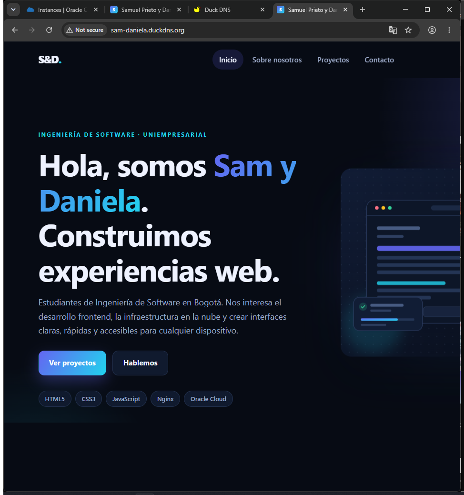

### Vista del sitio terminado

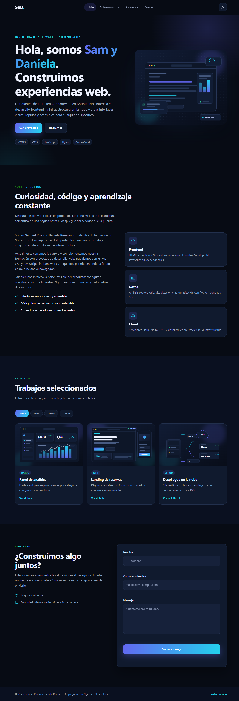

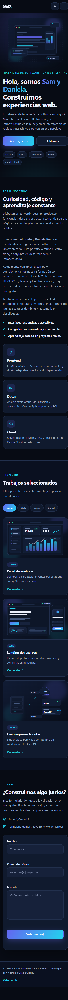

## Capturas

| Archivo | Qué muestra |
| --- | --- |
| `01-instancia.png` | Instancia `servidor-web-2` en OCI, estado Running, IP pública, imagen y forma. |
| `02-ssh.png` | Comando SSH desde Cloud Shell y datos de la VM. |
| `03-nginx.png` | Nginx 1.20.1 activo, servicio habilitado y puerto 80 escuchando. |
| `04-puerto-80.png` | `firewall-cmd --list-all` con HTTP y el puerto 80 habilitados. |
| `05-github.png` | Repositorio público con la guía y las capturas. |
| `06-archivos.png` | Archivos publicados en `/var/www/mi-sitio`. |
| `07-nginx-config.png` | `nginx -t` exitoso, `server_name` del dominio y respuesta 200. |
| `08-duckdns.png` | Subdominio `sam-daniela.duckdns.org` actualizado a la IP de la VM. |
| `09-navegador.png` | Sitio abierto desde un navegador externo con el dominio en la barra de direcciones. |
| `sitio-escritorio.png` | Vista completa del sitio en escritorio. |
| `sitio-movil.png` | Vista completa del sitio en un viewport móvil. |

## Problemas comunes

| Síntoma | Causa probable | Solución |
| --- | --- | --- |
| `403 Forbidden`. | SELinux bloquea los archivos fuera de `/usr/share/nginx/html`. | Ejecuta `semanage fcontext` y `restorecon` como en el paso 6. |
| El sitio muestra la página por defecto de Nginx. | El `server_name` no coincide o el bloque no está incluido. | Revisa `/etc/nginx/conf.d/mi-sitio.conf`, ejecuta `nginx -T` y recarga. |
| `404 Not Found`. | Los archivos no están en `/var/www/mi-sitio` o falta `index.html`. | Verifica con `ls -la /var/www/mi-sitio`. |
| El sitio funciona en la VM pero no desde Internet. | Falta la regla TCP 80 en OCI o en `firewalld`. | Revisa la Security List y `firewall-cmd --list-all`. |
| Nginx no arranca porque el puerto 80 está ocupado. | Otro servicio usa el puerto. | Identifica con `sudo ss -tlnp \| grep ':80 '` y detén el servicio que no corresponda. |
| El dominio no resuelve. | DuckDNS tiene otra IP o hay un error de escritura. | Corrige **current ip** y espera unos minutos. |
| `Permission denied (publickey)`. | Llave, usuario o permisos incorrectos. | Usa `opc` y la llave `llave-web-2.key`; restringe permisos con `icacls` en Windows. |
| El navegador intenta abrir `https://`. | Algunos navegadores fuerzan HTTPS. | Escribe explícitamente `http://sam-daniela.duckdns.org`. |
| El formulario “no envía”. | Es una demostración de validación en el navegador. | El mensaje de éxito lo indica; no se envían correos reales. |

## Comandos de referencia

```bash
# Dentro de la VM
sudo systemctl status nginx --no-pager
sudo systemctl reload nginx
sudo nginx -t
ls -la /var/www/mi-sitio
sudo firewall-cmd --list-all
sudo tail -n 40 /var/log/nginx/mi-sitio.error.log
```

```bash
# Desde Cloud Shell
ssh -i ~/llave-web-2.key opc@157.137.210.124
curl -sI http://sam-daniela.duckdns.org
```

```powershell
# Desde Windows
nslookup sam-daniela.duckdns.org
Resolve-DnsName sam-daniela.duckdns.org
```

## Checklist final

- [x] Instancia `servidor-web-2` en estado **Running** y con IP pública.
- [x] Nginx instalado, habilitado y activo.
- [x] Puerto 80 liberado y permitido en `firewalld` y en la Security List.
- [x] Sitio publicado en `/var/www/mi-sitio` con permisos y contexto SELinux correctos.
- [x] `sudo nginx -t` sin errores.
- [x] Subdominio `sam-daniela.duckdns.org` apuntando a `157.137.210.124`.
- [x] Sitio accesible desde un navegador externo por HTTP.
- [x] Diseño adaptable a móvil y funcionalidades JavaScript verificadas.
- [x] Repositorio público con la guía y las capturas visibles.
- [x] Enlaces de la guía y del subdominio verificados.
- [x] Instancia y repositorio disponibles para la verificación del docente.

## Cómo personalizar el sitio

- Textos y secciones: `sitio/index.html`.
- Colores, tipografías y diseño adaptable: variables al inicio de `sitio/css/styles.css`.
- Proyectos y sus detalles: objeto `PROJECTS` en `sitio/js/main.js`.
- Imágenes: reemplaza los archivos de `sitio/img/` conservando los nombres, o actualiza las rutas en el HTML.

---

**Autores:** Samuel Enrique Prieto Lozano y Daniela Ramirez  
**Sitio publicado:** `http://sam-daniela.duckdns.org`  
**Guía:** `https://github.com/iNxTSam/taller-nginx-web/blob/main/README.md`
